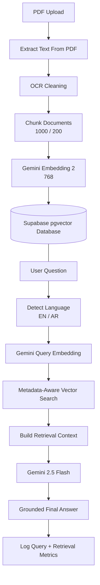
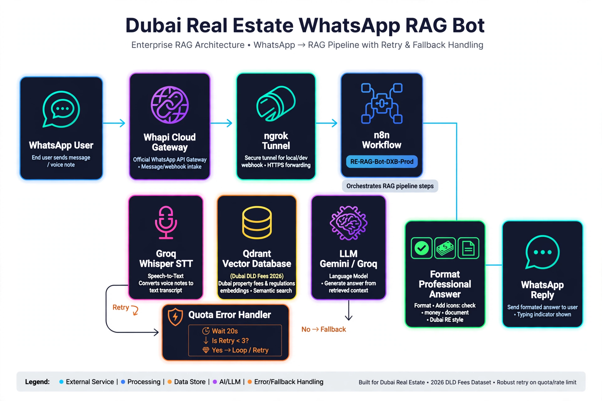
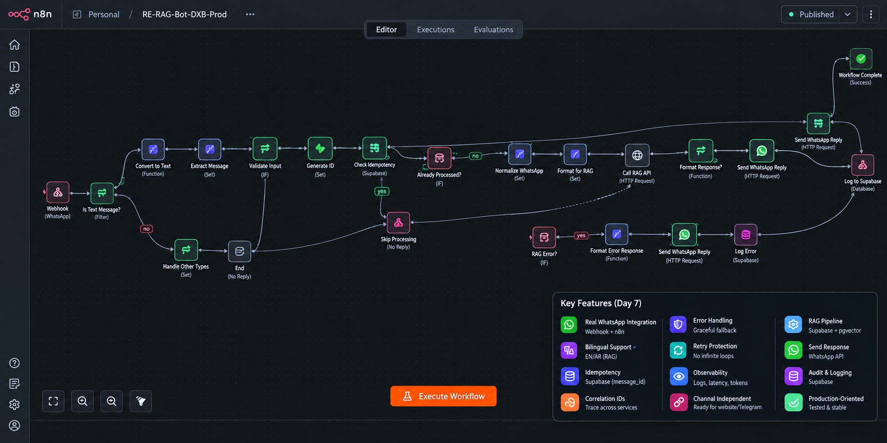
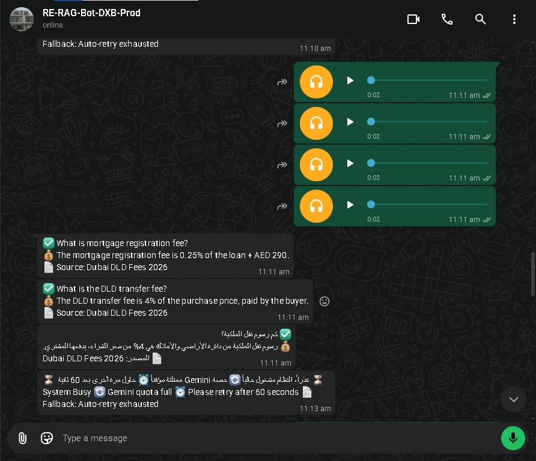
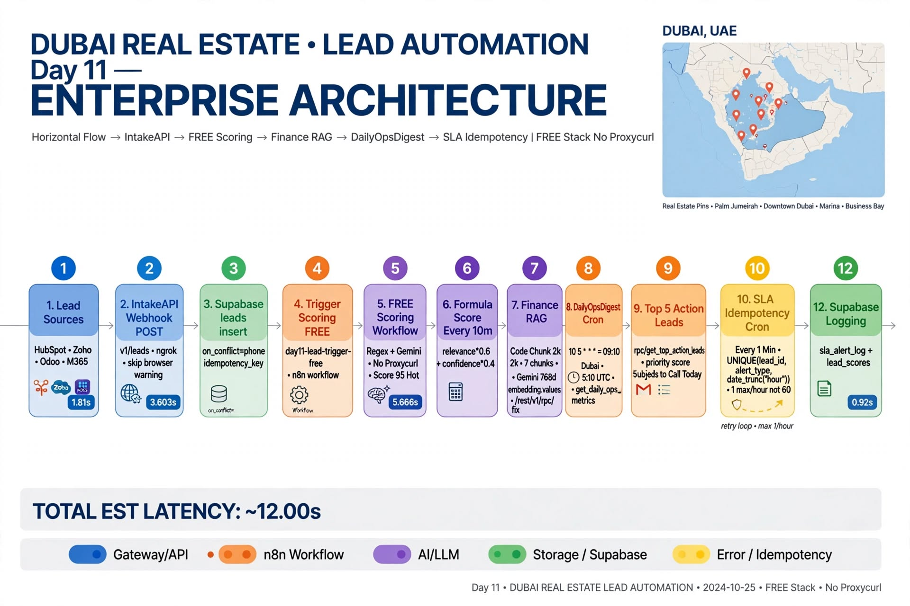
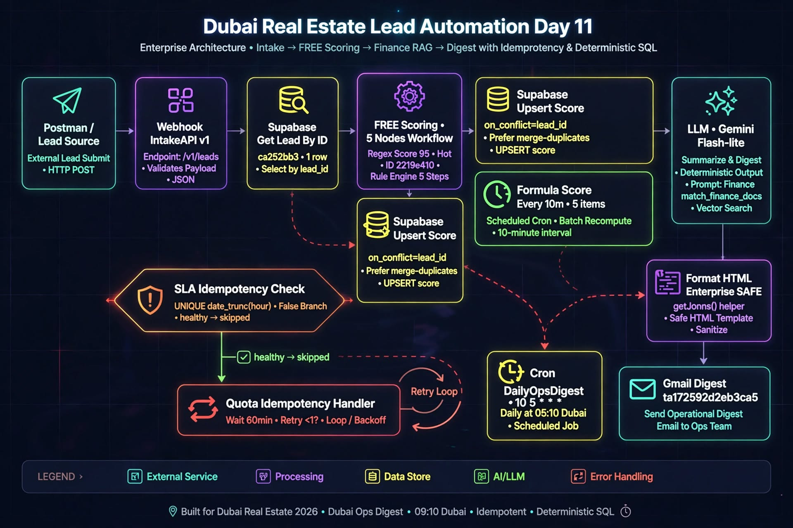
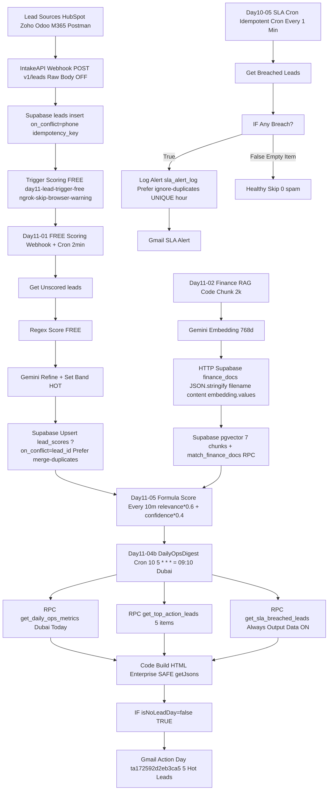
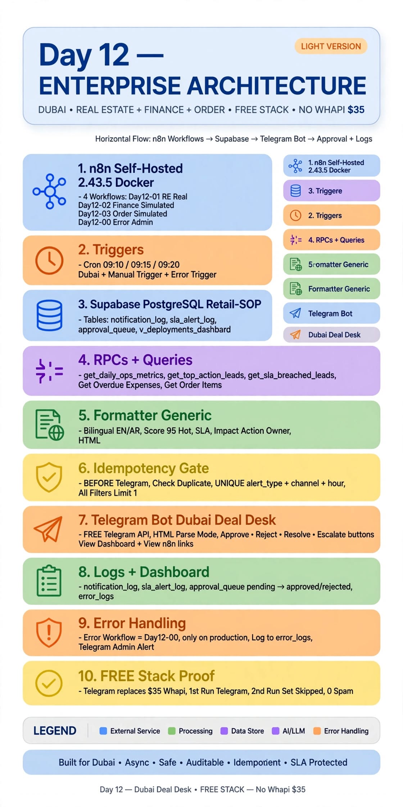
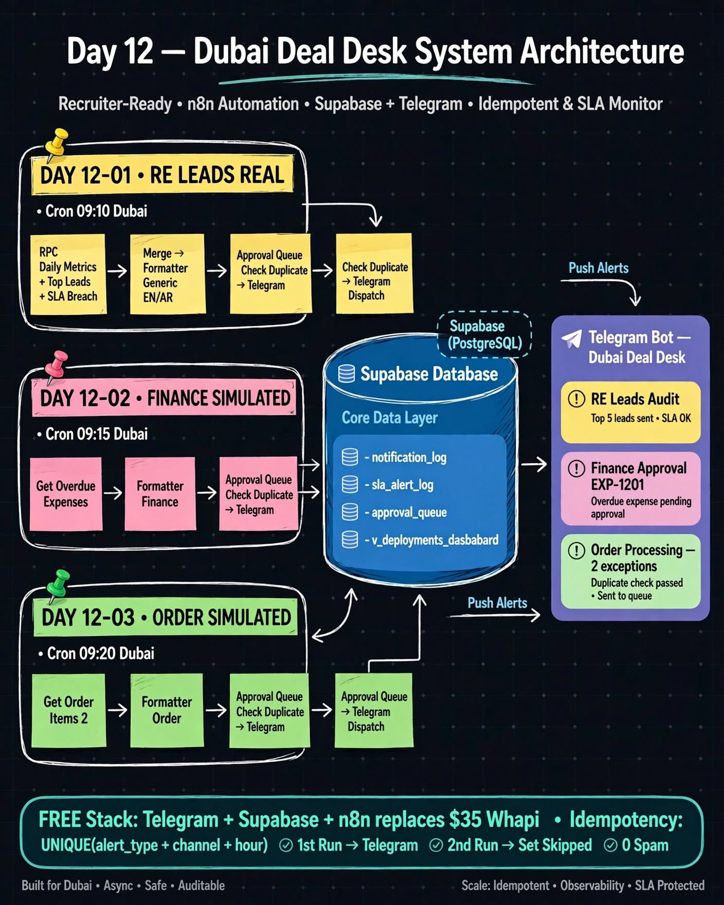
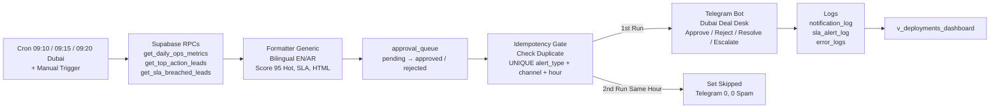

# 🚀 30-Day UAE AI Automation Sprint 🇦🇪

-success)

> Building production-grade AI Automation systems for the UAE market using n8n, Google Gemini, Supabase, RAG, and enterprise workflows.

---

# 🎯 Goal

Become job-ready for:

- AI Automation Engineer
- n8n Developer
- RAG Engineer
- AI Solutions Engineer

by building real-world production projects focused on UAE business use cases.

---

# 📌 Project Overview

This repository documents my **30-Day UAE AI Automation Sprint**.

Each day I build a practical AI automation project while learning production best practices used by modern companies.

The focus is on:

- Enterprise AI Automation
- Retrieval-Augmented Generation (RAG)
- Workflow Automation with n8n
- Google Gemini APIs
- Supabase pgvector
- Docker
- REST APIs
- English & Arabic AI systems

---

# 📅 Sprint Progress

| Day | Project | Tech Stack | Status |
|------|----------|------------|--------|
| Day 1 | AI Automation Foundations | AI Fundamentals | ✅ Complete |
| Day 2 | n8n Workflow Practice | n8n + JavaScript | ✅ Complete |
| Day 3 | Enterprise RAG Document Ingestion | n8n + Gemini Embedding 2 + Supabase pgvector | ✅ Complete |
| Day 4 | Enterprise RAG Retrieval API | n8n + RAG + Semantic Search | ✅ Complete |
| Day 5 | Enterprise HR Assistant API (Bilingual) | n8n + Gemini 2.5 Flash + Metadata RAG | ✅ Complete |
| Day 6 | Enterprise RAG API – Cross-Lingual + Observability | n8n + Gemini 2.5 Flash + Embedding 2 + pgvector + CorrelationID | ✅ Complete |
| Day 7 | Enterprise Dubai Real Estate WhatsApp RAG Bot – Voice + Text | n8n + Whapi Cloud + Groq Whisper + Qdrant + Gemini/Groq + Supabase | ✅ Complete |
| Day 8 | Dubai Real Estate Lead Automation – Intake + Qualification | n8n 2.39.8 + Gemini 3.5 Flash + Qdrant + Supabase + Whapi + Merge-Preserve | ✅ Complete |
| Day 9 | RE-LEAD-Engine-DXB – HubSpot CRM + Voice Reply + SLA Monitor | n8n 2.39.8 + Gemini 3.5 Flash + Groq Whisper + Supabase + HubSpot v3 + Whapi Buttons | ✅ Complete |
| Day 10 | RE-LEAD-Engine – SLA Idempotency + Owner Alert + Grounded 91.4% | n8n 2.39.8 + HubSpot + SLA Cron + Voice Reply Rename + Whapi | ✅ Complete |
| Day 11 | FREE Ops Digest Enterprise – No Proxycurl + Finance RAG + DailyOpsDigest | n8n 2.43.5 + Supabase pgvector 768d + Gemini 3.5 Flash Lite FREE + Gmail + ngrok | ✅ Complete |
| Day 12 | Dubai Deal Desk – Supervisor Lite + Human Approval | n8n 2.43.5 + Supabase PostgreSQL + Telegram Bot + Idempotency Gate | ✅ Complete |

---

# 🚀 Featured Projects

| Project | Repository | Stack | Status |
|---------|------------|-------|--------|
| Enterprise RAG API – Bilingual HR Assistant (EN/AR) | [enterprise-rag-api-bilingual-hr-assistant](https://github.com/Toqeer-Ahmad-ops/enterprise-rag-api-bilingual-hr-assistant) | n8n + Gemini 2.5 Flash + Embedding 2 (768) + Supabase pgvector + Metadata Search | ✅ Complete |
| Enterprise RAG API – Dubai Real Estate – Cross-Lingual + Observability (Day 6) | [dubai-real-estate-rag-api](https://github.com/Toqeer-Ahmad-ops/dubai-real-estate-rag-api) | n8n + Gemini 2.5 Flash + Embedding 2 + Qdrant + Supabase + Correlation IDs + RAG Observability | ✅ Complete |
| Enterprise WhatsApp RAG Bot – Voice + Text – Production (Day 7) | [dubai-real-estate-whatsapp-bot](https://github.com/Toqeer-Ahmad-ops/dubai-real-estate-whatsapp-bot) | n8n 2.39.8 + Whapi Cloud + Groq Whisper STT (2.3s) + Qdrant + Gemini/Groq LLM + Supabase pgvector + Idempotency + Quota Handler | ✅ Complete |
| Dubai Real Estate Lead Automation – Lead Intake + Qualification (Day 8) | [dubai-real-estate-lead-automation](https://github.com/Toqeer-Ahmad-ops/dubai-real-estate-lead-automation) | n8n + Gemini 3.5 Flash + Qdrant/pgvector + Supabase leads + Persistence Merge-Preserve + Whapi | ✅ Complete |
| RE-LEAD-Engine-DXB – HubSpot + Voice Reply + SLA Monitor (Day 9-10) | [RE-LEAD-Engine-DXB](https://github.com/Toqeer-Ahmad-ops/RE-LEAD-Engine-DXB) | n8n 2.39.8 + Gemini 3.5 Flash + Groq Whisper + Supabase + HubSpot CRM v3 Sync + Whapi Buttons + SLA Cron + Voice Reply | ✅ Complete |
| FREE Ops Digest Enterprise – No Proxycurl + Finance RAG + DailyOpsDigest (Day 11) | [Enterprise-Dubai-RE-Architecture-FREE-Ops-Digest](https://github.com/Toqeer-Ahmad-ops/Enterprise-Dubai-RE-Architecture-FREE-Ops-Digest) | n8n 2.43.5 + Supabase pgvector 768d + Gemini 3.5 Flash Lite FREE + Finance RAG 7 chunks + DailyOpsDigest 09:10 Dubai + SLA Idempotency 60min + Gmail | ✅ Complete |
| Dubai Deal Desk – Supervisor Lite + Human Approval (Day 12) | [Enterprise-Dubai-Deal-Desk-FREE-Supervisor-Lite](https://github.[STRIPPED 68 bytes]) | n8n 2.43.5 + Supabase PostgreSQL + Telegram Bot + Idempotency Gate + Approval Queue + SLA | ✅ Complete |

---

## 📚 Day 3 — Enterprise RAG Document Ingestion

Production-ready ingestion pipeline that:

- Receives HR documents through an API
- Splits documents into semantic chunks
- Generates vector embeddings
- Stores vectors inside Supabase pgvector
- Logs successful and failed ingestions

**Skills**

- n8n
- JavaScript
- Gemini Embedding 2
- Supabase
- PostgreSQL
- pgvector

🔗 Repository:
https://github.com/Toqeer-Ahmad-ops/enterprise-rag-api-bilingual-hr-assistant

---

## 🤖 Day 4 — Enterprise RAG Retrieval API

Production-ready bilingual Retrieval-Augmented Generation (RAG) API.

The workflow:

- Understands semantic meaning
- Performs vector similarity search
- Retrieves relevant company knowledge
- Generates grounded answers
- Supports English and Arabic
- Returns structured API responses

**Features**

- Semantic Search
- Enterprise RAG
- Prompt Engineering
- Source Attribution
- Bilingual Responses (EN/AR)
- Production API Design

🔗 Repository:
https://github.com/Toqeer-Ahmad-ops/enterprise-rag-api-bilingual-hr-assistant

---

## 🧠 Day 5 — Enterprise HR Assistant API (Bilingual) — NEW

**Complete end-to-end bilingual RAG system:**

- Metadata-aware retrieval (filter by project/developer/type)
- Cross-lingual AR→EN search
- Grounded, hallucination-resistant answers
- Enterprise logging + Postman-tested API
- Handles real Dubai HR documents

**Flow:** PDF Upload → Extract Text → OCR Cleaning → Chunk (1000/200) → Gemini Embedding 2 (768) → Supabase pgvector → User Question → Detect Language (EN/AR) → Query Embedding → Metadata-Aware Vector Search → Build Context → Gemini 2.5 Flash → Grounded Answer → Log Metrics

# 🏗 Architecture

  

📄 View Mermaid Source

🔗 Repository:
https://github.com/Toqeer-Ahmad-ops/enterprise-rag-api-bilingual-hr-assistant

---

## 🔍 Day 6 — Enterprise RAG API – Cross-Lingual + Observability

**Production cross-lingual RAG with enterprise observability:**

- AR MSA + Dubai dialect → EN search
- Correlation IDs across n8n → RAG API → Supabase
- RAG Observability: latency, tokens, grounded_rate
- 44s latency, 0.882 similarity – Enterprise logging

🔗 Repository:
https://github.com/Toqeer-Ahmad-ops/dubai-real-estate-rag-api

---

Repository: https://github.com/Toqeer-Ahmad-ops/dubai-real-estate-whatsapp-bot

## 🧠 Day 7 – Enterprise Dubai Real Estate WhatsApp RAG Bot (Voice + Text) – NEW

**Complete end-to-end production WhatsApp RAG system:**

- Real WhatsApp Integration (Whapi Cloud + Meta webhook + typing_time=5)
- Voice → Text – Groq Whisper STT (2.3s EN / 2.4s AR) + 4 simultaneous 0:02 audios handled
- Bilingual Support – Arabic MSA + Dubai dialect + English, same professional format
- Idempotency – Supabase message_id unique constraint, no duplicate processing
- Correlation IDs – Trace across Whapi → n8n → RAG API → Supabase
- Error Handling + Retry Protection – Gemini quota (429) → Wait 20s → Is Retry <3? → Fallback ⏳🔄⏰📄
- Professional Answer Formatting – ✅ What is...? 💰 fee 📄 Source: Dubai DLD Fees 2026
- Observability + Audit Logging – Latency, tokens, language, status, full trace
- Channel Independent – Same RAG API for website, Telegram, WhatsApp

**Flow:** WhatsApp User (text/voice 0:02) → Whapi Cloud Gateway → ngrok Tunnel → n8n Workflow RE-RAG-Bot-DXB-Prod → Is Text? Is Voice? → Groq Whisper STT → Check Message ID (Supabase) → Already processed? → Stop / Not processed → Call RAG API (Qdrant Vector DB + Gemini/Groq LLM) → Quota Error? → Wait 20s → Retry <3? → Format Professional Answer (JavaScript ✅💰📄) → Send WhatsApp Reply (HTTP) → Log to Supabase (Audit + Observability) → Workflow Complete

# 🏗 Architecture

  

📸 n8n Workflow + Production Proof

  
  

---

## 📊 Day 8 – Dubai Real Estate Lead Automation – Intake + Qualification + Persistence

**Production lead automation:**

- Lead Intake from WhatsApp → Validation → Find Existing Lead by `phone` unique
- Merge-Preserve Logic – preserves previous values if new message missing fields
- Deterministic Qualification – JS Node `bedrooms && location && budget_max>=1M`
- Supabase `leads` + `rag_audit_logs` + `processed_messages` – idempotency
- 91.4% grounded (53/58) carry-over from Day 7

🔗 Repository:
https://github.com/Toqeer-Ahmad-ops/dubai-real-estate-lead-automation

---

## 📱🏙️ Day 9-10 – RE-LEAD-Engine-DXB – HubSpot CRM + Voice Reply + SLA Monitor

**Day 9 Upgrade vs Day 8:**

- ⏸️ **Pause & Spam Guard** – `Check If Paused` → `Is Lead Paused?` → Prevents duplicate processing
- 🔘 **Button Click Router** – WhatsApp interactive buttons
- 🎙️ **Voice Pipeline** – `Is Voice?` → `Download Voice` → `Transcribe` (Groq Whisper 2.3s) → Same as text path
- 🔎 **HubSpot CRM Sync – NEW** – `HubSpot-Search Contact by Phone` → `IF-Contact Exists?` → `Create or update contact` → `Create deal` → `Code-Owner Message` → `WhatsApp-Owner Alert with Buttons` 📞 Call Lead 🔗 View in HubSpot
- 🗣️ **Voice Reply – NEW** – `Is Voice Input?` → `Voice Reply` → `Rename Voice` → `Whapi Send Voice`
- ⏰ **SLA Monitor Cron – NEW** – `Schedule Trigger (every 15min)` → `Get Overdue Leads` → `IF Validation` → `Send Whapi Alert`

🔗 Repository:
https://github.com/Toqeer-Ahmad-ops/RE-LEAD-Engine-DXB

---

## 📊🏙️ Day 11 – FREE Ops Digest Enterprise – No Proxycurl + Finance RAG + DailyOpsDigest + SLA Idempotency – NEW

**FREE Stack – No $49/mo Proxycurl – Production-grade Dubai Lead Automation:**

- 📥 **IntakeAPI** – `POST /v1/leads` → Validate → Normalize Enterprise (HubSpot/Zoho/Odoo/M365) → Supabase `leads` `on_conflict=phone` + `idempotency_key` → Trigger Scoring FREE `day11-lead-trigger-free` → **200 OK 1.81s** `ca252bb3-8fee-41b1-8b93-4b46ed00ce8b`
- 🧮 **FREE Scoring** – `Cron 2min + Webhook FREE` → Get Unscored → `Regex Score FREE` → `Gemini Refine` → `Set Band` HOT/WARM/COLD → Supabase Upsert `lead_scores` `?on_conflict=lead_id` + `Prefer: merge-duplicates` – Formula `relevance*0.6 + confidence*0.4` = **95 Hot 3.603s** `2219e410`
- 💰 **Finance RAG – FIXED** – `Code Chunk 2k` → `Gemini Embedding 768d` → `HTTP Raw JSON.stringify({filename, content, embedding})` → Supabase `finance_docs` **7 chunks** → `match_finance_docs` RPC – Fixed PGRST102
- 📊 **DailyOpsDigest – NEW** – `Cron 10 5 * * * = 09:10 Dubai` → `get_daily_ops_metrics()` + `get_top_action_leads()` 5 items + `get_sla_breached_leads()` → `Code Build HTML SAFE getJsons()` → `Gmail Action Day` **id ta172592d2eb3ca5** – Subject `📊 5 Hot Leads to Call Today – 23/10/2026`
- 🛡️ **SLA Idempotency – NEW** – `Cron * * * * *` → `get_sla_breached_leads()` → `IF Any Breach?` → `Log sla_alert_log` `Prefer: ignore-duplicates` `UNIQUE hour` → `Gmail Alert` – **60 emails/hour → 1 max/hour** – False Branch healthy skip = 0 spam

# 🏗 Architecture – Day 11

  
  

### 📊 Results – Day 11 – All Green

| Workflow | Exec | Latency | Proof |
|:---|:---|:---|:---|
| IntakeAPI | #3516 20:28:10 | **1.81s** 200 OK | `ca252bb3` |
| FREE Scoring | 21:28:39 | **3.603s 95 Hot** | `2219e410` |
| Finance RAG | 7/7 chunks | **768d >0.82** | 7 rows |
| DailyOpsDigest | 17:26:56 | **5.666s** | `ta172592d2eb3ca5` SENT |
| SLA Monitor | False Branch | **0 spam** | 60min idempotent |

🔗 Repository:
https://github.com/Toqeer-Ahmad-ops/Enterprise-Dubai-RE-Architecture-FREE-Ops-Digest

---

## 📊🏙 Day 12 – Dubai Deal Desk – Supervisor Lite + Human Approval – FREE Stack – NEW

**FREE Stack – Telegram replaces $35/mo Whapi – Production-grade Supervisor Lite:**

- 📥 **Day12-01 RE Leads Supervisor Lite – REAL, Production** – `Cron 10 5 * * * = 09:10 Dubai` → `RPC get_daily_ops_metrics()` + `get_top_action_leads()` + `get_sla_breached_leads()` → `Merge` → `Formatter Generic` Bilingual EN/AR → `Log Approval Queue` → `Check Duplicate` Supabase → `IF Duplicate?` → `Telegram Dispatch` – **28 leads, SLA breach in 1 min, Score 95 Hot**
- 💰 **Day12-02 Finance Approval – SIMULATED, honestly labelled** – `Cron 15 5 * * * = 09:15 Dubai` → `Get Overdue Expenses` → `Formatter Generic Finance` → `Log Approval Queue` → `Check Duplicate` → `Telegram` – **EXP-1201 AED 12000 Overdue Conf 0.82 | EXP-1202 AED 8500** – ✅ Approve / ❌ Reject – human decides, not bot
- 📦 **Day12-03 Order Processing – SIMULATED** – `Cron 20 5 * * * = 09:20 Dubai` → `Get Order Items` → `Formatter Generic Order` → `Log Approval Queue` → `Check Duplicate` → `Telegram` – **ORD-8821 payment_failed AED 450 + ORD-8822 stock_short AED 1200 | At Risk AED 1650** – ✅ Resolve / ❌ Escalate
- ⚠️ **Day12-00 Error Trigger Admin** – Production only. Short error. No JSON dump. No secrets. Logs to `error_logs` + Telegram Admin Alert
- 🛡 **Idempotency Gate – NEW** – `Check Duplicate` BEFORE Telegram → `UNIQUE(lead_id, alert_type, hour, channel)` `ux_notification_log_hour` – **1st Run = Telegram ✅ / 2nd Run Same Hour = Set Skipped, Telegram 0 ✅ / 0 Spam** – Fixed first-run 50-message spam bug

# 🏗 Architecture – Day 12

  
  

### 📊 Results – Day 12 – All Green After Fix

| Workflow | Exec | Latency | Proof |
|:---|:---|:---|:---|
| Day12-01 RE Leads | #29392 09:29:15 | 2.433s Succeeded | Version `46b00ff3` Published, Supabase notification_log, Set Skipped|
| Day12-02 Finance | #26684 14:06:36 | 1.425s Succeeded | Set Skipped, Telegram 0, 2nd run |
| Day12-03 Order | #28156 05:20:00 | 1.763s Succeeded | Set Skipped, Telegram 0, 2nd run |
| Day12-00 Error Admin | Production only | — | Short error, no secrets, error_logs |

🔗 Repository:
[https://github.com/Toqeer-Ahmad-ops/Enterprise-Dubai-RE-Architecture-FREE-Ops-Digest](https://github.com/Toqeer-Ahmad-ops/Enterprise-Dubai-Deal-Desk-FREE-Supervisor-Lite)

---

# 📈 Current Learning Roadmap

✅ Workflow Automation – n8n 2.43.5 + JavaScript functions + SAFE getJsons() + Always Output Data ON

✅ Vector Databases – Supabase pgvector 768d + Qdrant + HNSW indexing + finance_docs 7 chunks

✅ Enterprise RAG – Ingestion (Gemini Embedding 2) + Retrieval + Metadata-aware + Finance RAG 0.82 similarity

✅ API Development – RAG API + IntakeAPI 1.81s + Observability + Postman-tested + Correlation IDs + ngrok

✅ Lead Scoring FREE – Regex + Gemini Refine + Formula relevance*0.6 + confidence*0.4 + 95 Hot + No Proxycurl

✅ DailyOpsDigest + SLA Idempotency – Cron 09:10 Dubai + get_daily_ops_metrics() + get_top_action_leads() + get_sla_breached_leads() + Gmail + UNIQUE hour

✅ Prompt Engineering – Grounded answers + Bilingual EN/AR + Anti-hallucination + Finance RAG

✅ Enterprise AI Agents – Idempotency + Retry Protection + Quota Handler + Audit Logging + Response Immediately

✅ WhatsApp Automation – Whapi Cloud + Webhook + Typing indicators + 4 simultaneous audios + Buttons Click Router + Owner Alert

✅ AI Voice Agents – STT Groq Whisper (2.3s EN / 2.4s AR) + Voice → Text contract + Voice Reply Rename + Whapi Send Voice

🚧 Multi-Agent Systems – Supervisor + Sub-agents + Tool orchestration

🚧 MCP Servers – Model Context Protocol + Tool servers + Claude integration

🚧 AI Evaluation – RAGAS + Faithfulness + Latency metrics + Production monitoring

---

# 🌍 Target Use Cases

Projects are designed around real UAE business scenarios such as:

- HR Assistants
- Employee Handbooks
- SOP Search
- Internal Knowledge Bases
- Real Estate Lead Automation – FREE Stack
- Finance RAG + Ops Digest
- Healthcare
- Legal Documents
- Customer Support Automation

---

# 📂 Portfolio Structure

This repository serves as the central portfolio for my 30-Day UAE AI Automation Sprint.

Each major project is published in its own dedicated GitHub repository with documentation, workflows, screenshots, and source code.

The sprint repository tracks my learning journey and links to each completed project.

---

# 🎯 Career Goal

I'm building this portfolio publicly while preparing for opportunities as an:

- AI Automation Engineer
- n8n Developer
- RAG Engineer
- AI Solutions Engineer

📍 Dubai, UAE

🌍 Open to Remote Opportunities

---

# 📬 Connect With Me

**Toqeer Ahmad**

📍 Dubai, UAE 🇦🇪

🔗 LinkedIn

https://www.linkedin.com/in/toqeer-ahmad-498800220

⭐ Follow my journey as I build one production-ready AI automation project every day.
